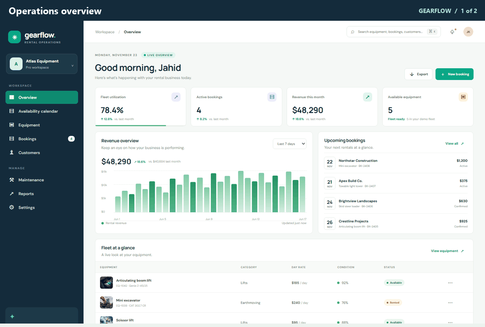

# Gearflow

Gearflow helps equipment rental teams check fleet availability, create bookings, and manage service from one workspace. The demo starts with sample records and runs in your browser.

## Product tour



Follow the availability calendar into the fleet and bookings views. [Browse all 12 full-page screenshots](docs/media/screenshots), including the booking, equipment, customer, and workspace forms.

## Key features

- See upcoming pickups and current reservations on the fleet availability calendar.
- Search and filter equipment, check its condition, and change service availability.
- Create a booking with a customer, asset, and rental dates. The app calculates the total and marks the asset as rented.
- Browse and add customers, and return inventory-backed assets to availability from the service queue.
- Review a demo business snapshot, see equipment ranked by day rate, and export fleet or booking records as CSV.

<details>
<summary>Workspace reference</summary>

| Workspace | What to look for |
| --- | --- |
| Overview | Fleet counts, upcoming bookings, and an illustrative revenue chart |
| Availability calendar | Reservations and availability by asset |
| Equipment | Search, category filters, condition, and service availability |
| Bookings | Reservation list and booking form |
| Customers | Contact records and sample rental history |
| Maintenance | Service queue and completion for inventory-backed assets |
| Reports | Illustrative KPIs, equipment ranked by day rate, and booking CSV export |
| Settings | Workspace name, a demo notification toggle, and sample data reset |

</details>

## Tech stack

| Area | Technologies |
| --- | --- |
| Active workspace | React 16, JavaScript, CSS |
| Persistence | Browser local storage with a namespaced adapter |
| Build and hosting | Create React App 3, Webpack 4, static hosting |
| Tests | Jest via React Scripts, React Testing Library |

Material UI 4 remains a dependency of the retained legacy product management components.

## Architecture

The workspace shell in [App.js](src/App/App.js) manages the active view, records, and booking workflow. It initializes each record collection through the [storage adapter](src/data/storage.js) using [demo data](src/data/demoData.js) as the fallback. React state updates keep the views in sync, and effects write changed data to storage.

| Data | What it stores |
| --- | --- |
| Equipment | Inventory code, category, day rate, availability, and condition |
| Bookings | Customer, assigned asset, rental dates, amount, and status |
| Customers | Organization, contact details, reservation count, and lifetime value |
| Workspace | The editable organization name |

## Engineering decisions

- **Keep the demo local.** Equipment, bookings, customers, and workspace name are stored separately under `gearflow:` keys. Missing or unparseable values fall back independently, and a failed write leaves the current in-memory session usable.
- **Validate bookings before updating the workspace.** The app checks that the asset is available and that the return date follows the pickup date. It calculates the total from the day rate and rental length, adds the booking, and marks the asset as rented. Separate browser storage writes do not guarantee conflict-safe reservations across users.
- **Scope build compatibility to the launcher.** The [launcher](scripts/react-scripts.js) supplies the legacy OpenSSL provider to the React Scripts start and build commands so the existing Webpack 4 toolchain can run on newer Node versions.

## Getting started

Use Node.js 18 or later and npm 9 or later. From the repository root:

```bash
npm install
npm start
```

Open `http://localhost:3000`. There is no account, backend, or application environment variable setup.

### Static deployment

```bash
npm run build
```

Serve the `build/` directory on a static host. If you deploy under a path prefix, configure Create React App’s `homepage` for that location before building.

## Guided demo

1. Start in **Availability calendar** and inspect the schedule and upcoming pickups.
2. Choose **New booking**. Select an available asset and a customer, then set the pickup and return dates.
3. Open **Bookings** to see the reservation and **Equipment** to see the asset marked rented. Refresh to confirm both records persist.

Try **Settings → Edit profile** to change the sample organization name. **Reset demo data** restores the original workspace and sample records.

## Quality baseline

```bash
npm test -- --watchAll=false --runInBand --no-cache
```

Both tests pass locally. They cover the seeded availability calendar and booking price, asset status, and persistence after reopening the app. React Scripts supplies ESLint configuration. Run tests and a production build together with `npm run check`. The [Quality checks workflow](.github/workflows/quality.yml) runs it on pushes and pull requests. The workflow and pre-push hook set `CI=true` so React Scripts treats compiler warnings as errors.

### Pre-push hook

After installing dependencies, enable the hook once per clone:

```bash
git config --local core.hooksPath .githooks
```

Git blocks the push if the tests or production build fail.

## Known limitations and roadmap

- Revenue, utilization, rental days, and on-time-return metrics are illustrative. The revenue period selector does not recalculate the chart. The Reports equipment table ranks by day rate.
- The notification toggle is display-only. It does not persist a preference or send email.
- **Mark fixed** updates inventory-backed assets. The extra Hydraulic breaker sample row is static and remains in the service queue.
- Browser storage is local to this browser and has no schema validation for parseable values. The demo has no server-side auth, shared database, or cross-user reservation checks. Use sample data in the showcase.
- Equipment thumbnails and web fonts load from external hosts.

The next steps are to modernize the build toolchain, extract feature modules, and add an authenticated API with organization-scoped data and conflict-safe reservations. Broader integration and accessibility coverage and CI would support those changes.

## License

This project is licensed under the [MIT License](LICENSE).

## Author

**Jahid Khan Tuhin** · Full-stack JavaScript engineer

[LinkedIn](https://www.linkedin.com/in/jahidkhantuhin/)
